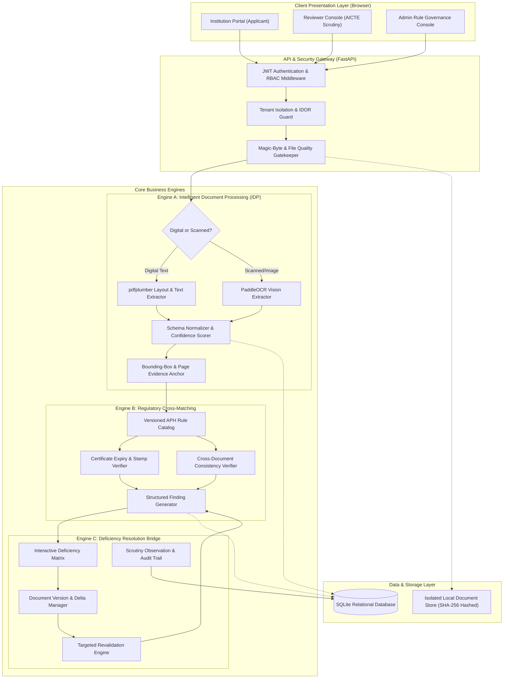

# AICTE Pre-Scrutiny & Deficiency Resolution Platform
## System Architecture Blueprint (`ARCHITECTURE.md`)

**Document Version:** 1.0.0  
**Phase:** Phase P1 — Specification & Architecture Blueprint  
**Status:** Approved Architecture Baseline  
**Disclaimer:** *SIH Prototype — Not an official AICTE portal.*

---

## 1. Verified Technology Stack (Ground-Truth from P0 Audit)

The platform architecture is designed to execute reliably on the audited host environment (Windows 10/11, Python 3.13.15, Node.js v22.23.2) without requiring Docker, external message brokers, or heavy enterprise microservices.

| Layer | Selected Technology | Ground-Truth Rationale |
| :--- | :--- | :--- |
| **Backend Framework** | **FastAPI 0.115.11** + **Uvicorn 0.40.0** | Asynchronous, high-throughput, native OpenAPI documentation, strict request validation via Pydantic v2. |
| **Validation & Schemas** | **Pydantic 2.12.5** | Type-safe schema validation, fast Rust-based core parsing, zero serialization boilerplate. |
| **Persistence / ORM** | **SQLAlchemy 2.0.45** (Engine with WAL & FK pragmas) + **SQLite 3** | Zero-configuration, zero-external-daemon relational database running locally with complete foreign-key enforcement and ACID transactions via Alembic migrations. |
| **PDF & Digital Text** | **pdfplumber 0.11.10** + **pypdf 6.19.0** | Robust extraction of embedded PDF text streams, word bounding boxes, and table matrices without native C-compiler prerequisites. |
| **Image & OCR Engine** | **PaddleOCR 3.7.0** + **ONNXRuntime 1.27.0** + **pypdfium2 5.6.0** + **Pillow 12.2.0** + **OpenCV (`cv2`)** | Pure-Python/bundled inference fallback for scanned documents and images utilizing CPU-optimized ONNXRuntime execution with PP-OCRv6 models; eliminates OS-level `tesseract.exe` binaries that are missing on Windows. |
| **Frontend Presentation** | **Modular Vanilla HTML5 / Modern CSS / ES6 JavaScript** | Single-Page Application (SPA) architecture utilizing component-based DOM rendering, CSS custom properties, and zero node-module bundling fragility. High performance, zero build-step overhead. |
| **Test Engine** | **Pytest 9.1.1** + **HTTPX** | Standardized asynchronous test harness covering unit, integration, and end-to-end API workflows. |

---

## 2. Target Architecture Overview

The system follows a **Modular Clean Monolith** architecture with strict separation of concerns, clear dependency boundaries, and unidirectional data flow.



---

## 3. Detailed Component Responsibilities

### 3.1 Presentation Layer (Frontend)
- **Institution Dashboard:** Displays active applications, checklist completion progress, real-time extraction statuses, and deficiency alert cards.
- **Side-by-Side Evidence Viewer:** A split-pane viewer displaying the actionable finding details on the left, and the live PDF document rendered on the right with a visual highlight overlay on the exact bounding box `[ymin, xmin, ymax, xmax]`.
- **Deficiency Resolution Bridge:** Interactive interface allowing institutions to submit document version 2 (`v2`) with explanatory notes targeted directly at an open finding.
- **Reviewer Scrutiny Console:** Queue of assigned applications with quick-filter chips (`All Clear`, `Deficiencies Detected`, `Revalidated`), observation editor, and pre-scrutiny summary generator.

### 3.2 Ingestion & Document Processing (Engine A)
- **Input Validation:** Enforces file type verification via magic bytes (`%PDF-`), blocks corrupt or zero-byte streams, and verifies file sizes ($\le 15$ MB).
- **Quality Gatekeeper:** Checks document DPI and page count. Warns user if scans are low-contrast or illegible.
- **Hybrid Extraction Pipeline:**
  - Evaluates character density using `pdfplumber`. If character density $> 50$ chars/page, processes digital stream directly (fast path, $< 300$ ms/page).
  - If character density $\le 50$ chars/page, renders page to image at 200 DPI and invokes `PaddleOCR` (deep path, ~1.5s/page).
- **Evidence Anchor:** Records character and word coordinates relative to page dimensions (`[0.0, 1.0]` normalized space) to enable frontend visual bounding boxes.

### 3.3 Regulatory Cross-Matching (Engine B)
- **Rule Governance:** Loads rules from the `RegulatoryRuleCatalog`. Each rule specifies required fields, threshold logic, and expected outcomes.
- **Execution Strategy:**
  - *Single-Document Rules:* Evaluates individual parameters (e.g., Fire NOC validity date $\ge$ current academic session).
  - *Cross-Document Rules:* Compares fields across distinct documents (e.g., Land Title Survey Number vs Land Use Certificate Survey Number; Building Plan Carpet Area vs Building Completion Area).
  - *Application-Record Checks:* Reconciles institutional declarations in the application form against certified values in uploaded documents (e.g., Declared Faculty Count vs Cadre Roster).
- **Finding Generation:** Produces immutable `Finding` records with deterministic IDs, severity ratings (`DEFICIENCY`, `WARNING`, `INFO`), and explicit next-action guidance.

### 3.4 Deficiency Resolution Bridge (Engine C) - Phase P8 Architecture
- **Correction Lifecycle & Persistence:** Managed via the relational `CorrectionSubmission` entity supporting multi-cycle revisions (`cycle_number`), draft saving (`DRAFT`), formal submission (`SUBMITTED`), and document replacement links (`attached_document_version_id`).
- **Applicant Acknowledgement:** Institutions explicitly acknowledge actionable findings (`acknowledged_at`, `acknowledged_by_user_id`), transitioning them from raw detection to active institutional engagement.
- **Controlled Revalidation Engine:** Triggered via `POST /api/v1/applications/{id}/revalidate`, invoking the real P7 `RegulatoryEngine.evaluate_application(..., trigger_type="CORRECTION_REVALIDATION")`. Unprocessed replacement document versions undergo automatic P6 `DocumentProcessingPipeline` extraction before regulatory evaluation begins.
- **Truthful Before-vs-After Delta Comparison:** Compares previous and revalidation findings by immutable rule code:
  - `CLEARED`: The deficiency condition is no longer detected in the newly submitted evidence.
  - `PERSISTS`: The non-compliant condition continues to be triggered despite corrective remarks or files.
  - `NEW`: Newly triggered deficiency introduced by updated evidence or cross-document contradiction.
- **Automated Outcome vs. Human Reviewer Disposition:** Clearing an automated condition marks the finding as `AWAITING_REVIEW` with reviewer handoff disposition `PENDING_REVIEW`. Automated revalidation **never** automatically issues official statutory approval or rejection.
- **Chronological History & Provenance:** Every finding exposes an immutable timeline (`GET /api/v1/findings/{id}/history`) combining initial detection, applicant acknowledgement, draft modifications, formal submissions, revalidation evaluation runs, and audit logs.

### 3.5 Reviewer Workspace & Administration Architecture (Phase P9)
- **Operational Reviewer Queue:** Live database-driven worklist of applications pending human scrutiny with real-time operational KPI metrics (awaiting scrutiny, pending responses, assigned to me, under scrutiny, recommended clear, returned for correction).
- **Comprehensive Scrutiny Console:** Unifies institutional profile, statutory document checklist, evidence-anchored findings with spatial bounding boxes, P8 applicant corrective submissions, and automated revalidation before-vs-after deltas into an ergonomic scrutiny interface.
- **Human Scrutiny State Machine:**
  - Finding-level observations: `CONCUR_DEFICIENCY`, `ACCEPT_CORRECTION`, `OVERRULE_DEFICIENCY`, `REQUIRE_ADDITIONAL_EVIDENCE`.
  - Application-level pre-scrutiny stage signoff: `PRE_SCRUTINY_RECOMMENDED_CLEAR`, `RETURNED_FOR_CORRECTION`, `FURTHER_REVIEW_REQUIRED`.
  - Separation of automated findings from human dispositions: automated rule outcomes (`DEFICIENCY_DETECTED`) are permanently preserved in historical runs; reviewer dispositions are recorded as distinct relational observations with mandatory justification and audit logging.
  - Reviewer assignment & reassignment: verified reviewer eligibility (must have `REVIEWER` or `ADMIN` role and be active).
- **Platform Administration & Governance:**
  - Administrative overview metrics aggregated directly from database tables (users, institutions, applications, reviews, audit logs).
  - User Directory & Provisioning: secure bcrypt hashing, role enforcement, active status toggling, and self-lockout/self-demotion protection.
  - Institution Metadata Management: update classification and rural/urban statuses without altering immutable AICTE Permanent IDs.
  - Regulatory Rule Governance: toggle rule activation state with strict `ADMIN` RBAC verification.
  - Tamper-Evident Audit Event Stream: filterable query interface over append-only audit records.
- **Decision-Support Boundary:** The platform is an advisory pre-scrutiny prototype and explicitly maintains that reviewer stage signoffs do not represent official AICTE statutory approval or denial.

---

## 4. Synchronous vs. Asynchronous Processing Strategy

In an enterprise cloud setup, document processing is offloaded to Celery/RabbitMQ or AWS SQS. For this local hackathon MVP:
- Heavy external message brokers are explicitly avoided to guarantee zero-installation reliability on Windows.
- The platform uses **FastAPI `BackgroundTasks`** coupled with an internal asynchronous state machine:
  1. Document upload is **synchronous** ($< 200$ ms): File is validated, stored, hashed, and returns HTTP 202 Accepted with a `task_id`.
  2. OCR and Extraction run as a **non-blocking background task**.
  3. The client polls `GET /api/v1/documents/{id}/status` or receives status updates until status transitions to `PROCESSED`.
  4. Regulatory validation is triggered synchronously on-demand via `POST /api/v1/applications/{id}/validate` ($< 500$ ms for 8 documents) since structured rule cross-matching is fast once fields are extracted.

---

## 5. File Storage Architecture

Uploaded documents are stored in a dedicated, isolated directory structure outside the web server's static root to prevent unauthorized direct URL access:

```
storage/
  └── documents/
        └── {institution_id}/
              └── {application_id}/
                    └── {document_type}/
                          ├── v1_{file_hash_prefix}.pdf
                          ├── v1_meta.json
                          ├── v2_{file_hash_prefix}.pdf
                          └── v2_meta.json
```

- Direct URL access to files is strictly blocked.
- Files can only be streamed via the authenticated API route:
  `GET /api/v1/documents/{document_id}/versions/{version_number}/file`
  which validates JWT identity and institutional tenant authorization before transmitting bytes.

---

## 6. External Verification Boundary (Sandbox Connector)

Certain statutory verifications (e.g., checking Fire NOC validity against State Fire Portals or Land Title Registration against State Bhulekh/Land Records) cannot connect to live government databases during a hackathon without official API credentials.

The platform establishes a strict **Verification Provider Interface**:
```python
class VerificationConnector(Protocol):
    async def verify_record(
        self, record_type: str, identifier: str, metadata: dict
    ) -> VerificationResult:
        ...
```
- For the prototype, an explicit `MockSandboxConnector` implements this interface.
- Synthetic responses are explicitly tagged:
  `verification_status: "VERIFIED_SIMULATED"` or `"SOURCE_UNAVAILABLE"`.
- Under no circumstance does the platform pretend a mock response is a live government confirmation.

---

## 7. Error Handling, Resilience & Recovery

1. **Corrupted / Damaged PDF:** Ingestion rejects the file with HTTP 422 Unprocessable Entity, returning detailed error diagnostics (e.g. `PDF_HEADER_CORRUPTED`, `PASSWORD_PROTECTION_DETECTED`).
2. **Low-Confidence OCR:** If OCR confidence falls below 0.60 on key numerical fields, the system does not guess. It creates an `INFO`/`WARNING` finding: `LOW_EXTRACTION_CONFIDENCE`, prompting manual verification.
3. **Database Concurrency:** SQLite is configured with Write-Ahead Logging (`WAL` mode) and busy timeout of 5000ms to allow concurrent reads during background OCR writes.
4. **Crash Recovery:** If the background extraction task is interrupted, the document status remains `EXTRACTION_FAILED`, allowing the institution user to click "Retry Processing" with a single click.
