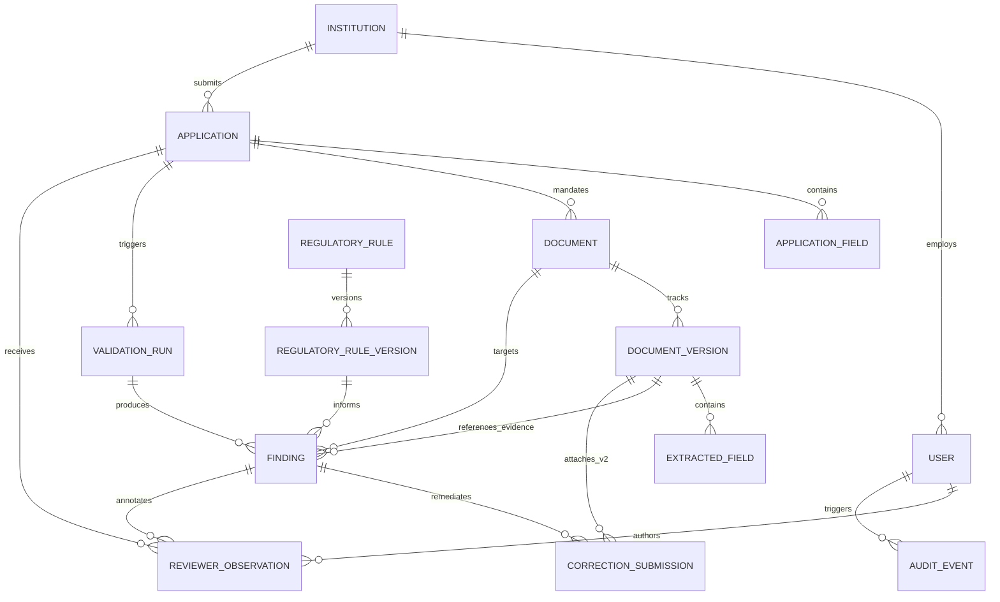

# AICTE Pre-Scrutiny & Deficiency Resolution Platform
## Logical & Relational Data Model Specification (`DATA_MODEL.md`)

**Document Version:** 1.0.0  
**Phase:** Phase P1 — Specification & Architecture Blueprint  
**Status:** Approved Data Architecture Baseline  
**Disclaimer:** *SIH Prototype — Not an official AICTE portal.*

---

## 1. Entity-Relationship Diagram (ERD)



---

## 2. Relational Entity Specifications

### 2.1 `institutions`
Represents an AICTE-approved educational institution.
```sql
CREATE TABLE institutions (
    id TEXT PRIMARY KEY,                       -- UUID v4
    aicte_permanent_id TEXT UNIQUE NOT NULL,   -- e.g. "1-10972412"
    name TEXT NOT NULL,                        -- e.g. "Apex Institute of Technology"
    category TEXT NOT NULL,                    -- "ENGINEERING_TECHNOLOGY", "MANAGEMENT", etc.
    state TEXT NOT NULL,                       -- e.g. "Karnataka"
    district TEXT NOT NULL,                    -- e.g. "Bengaluru Urban"
    is_rural BOOLEAN NOT NULL DEFAULT 0,       -- 1=Rural, 0=Urban/Metro (affects land rules)
    created_at TIMESTAMP NOT NULL DEFAULT CURRENT_TIMESTAMP
);
CREATE INDEX idx_institutions_aicte_id ON institutions(aicte_permanent_id);
```

### 2.2 `users`
Authenticated user accounts categorized by role.
```sql
CREATE TABLE users (
    id TEXT PRIMARY KEY,                       -- UUID v4
    email TEXT UNIQUE NOT NULL,                -- User login email
    password_hash TEXT NOT NULL,               -- bcrypt hashed password
    full_name TEXT NOT NULL,                   -- Display name
    role TEXT NOT NULL,                        -- "INSTITUTION", "REVIEWER", "ADMIN"
    institution_id TEXT,                       -- FK to institutions(id), NULL for Reviewer/Admin
    is_active BOOLEAN NOT NULL DEFAULT 1,
    created_at TIMESTAMP NOT NULL DEFAULT CURRENT_TIMESTAMP,
    last_login_at TIMESTAMP,
    FOREIGN KEY (institution_id) REFERENCES institutions(id) ON DELETE RESTRICT
);
CREATE INDEX idx_users_email ON users(email);
CREATE INDEX idx_users_institution ON users(institution_id);
```

### 2.3 `applications`
An Extension of Approval (EoA) application submission.
```sql
CREATE TABLE applications (
    id TEXT PRIMARY KEY,                       -- UUID v4
    application_number TEXT UNIQUE NOT NULL,   -- e.g. "AICTE-EOA-2026-9812"
    institution_id TEXT NOT NULL,              -- FK to institutions(id)
    academic_year TEXT NOT NULL,               -- e.g. "2026-2027"
    application_type TEXT NOT NULL DEFAULT 'EOA',
    status TEXT NOT NULL,                      -- 'DRAFT', 'PROCESSING', 'FINDINGS_AVAILABLE',
                                               -- 'DEFICIENCIES_DETECTED', 'REVALIDATED',
                                               -- 'SUBMITTED_FOR_REVIEW', 'REVIEWED'
    total_intake_applied INTEGER NOT NULL DEFAULT 0,
    assigned_reviewer_id TEXT,                 -- FK to users(id)
    assigned_at TIMESTAMP,                     -- Assignment timestamp
    review_status TEXT,                        -- 'UNASSIGNED', 'UNDER_SCRUTINY', 'PRE_SCRUTINY_RECOMMENDED_CLEAR', 'RETURNED_FOR_CORRECTION', 'FURTHER_REVIEW_REQUIRED'
    overall_reviewer_remarks TEXT,             -- Stage signoff remarks
    scrutiny_completed_at TIMESTAMP,           -- Timestamp of pre-scrutiny stage completion
    created_at TIMESTAMP NOT NULL DEFAULT CURRENT_TIMESTAMP,
    updated_at TIMESTAMP NOT NULL DEFAULT CURRENT_TIMESTAMP,
    FOREIGN KEY (institution_id) REFERENCES institutions(id) ON DELETE CASCADE,
    FOREIGN KEY (assigned_reviewer_id) REFERENCES users(id) ON DELETE SET NULL
);
CREATE INDEX idx_applications_institution ON applications(institution_id);
CREATE INDEX idx_applications_status ON applications(status);
CREATE INDEX idx_applications_assigned_reviewer ON applications(assigned_reviewer_id);
```

### 2.4 `application_fields`
Declared institutional parameters in the application form (e.g. Total Land Area, Enrolled Students).
```sql
CREATE TABLE application_fields (
    id TEXT PRIMARY KEY,                       -- UUID v4
    application_id TEXT NOT NULL,
    field_key TEXT NOT NULL,                   -- e.g. "declared_land_acres", "total_intake"
    field_label TEXT NOT NULL,
    declared_value TEXT NOT NULL,              -- Raw string / numeric
    unit TEXT,                                 -- e.g. "Acres", "Sq. Meters", "Students"
    created_at TIMESTAMP NOT NULL DEFAULT CURRENT_TIMESTAMP,
    FOREIGN KEY (application_id) REFERENCES applications(id) ON DELETE CASCADE,
    UNIQUE(application_id, field_key)
);
CREATE INDEX idx_app_fields_app_id ON application_fields(application_id);
```

### 2.5 `documents`
Logical document slots required for the application checklist.
```sql
CREATE TABLE documents (
    id TEXT PRIMARY KEY,                       -- UUID v4
    application_id TEXT NOT NULL,
    document_type TEXT NOT NULL,               -- 'LAND_TITLE_DEED', 'LAND_USE_CERTIFICATE',
                                               -- 'APPROVED_BUILDING_PLAN', 'BUILDING_COMPLETION',
                                               -- 'FIRE_SAFETY_NOC', 'STRUCTURAL_STABILITY',
                                               -- 'PREV_AICTE_APPROVAL', 'FACULTY_ROSTER'
    title TEXT NOT NULL,
    is_mandatory BOOLEAN NOT NULL DEFAULT 1,
    current_version_id TEXT,                   -- FK to documents_versions(id)
    status TEXT NOT NULL DEFAULT 'PENDING',    -- 'PENDING', 'UPLOADED', 'PROCESSING',
                                               -- 'PROCESSED', 'FAILED'
    created_at TIMESTAMP NOT NULL DEFAULT CURRENT_TIMESTAMP,
    FOREIGN KEY (application_id) REFERENCES applications(id) ON DELETE CASCADE
);
CREATE INDEX idx_documents_app_id ON documents(application_id);
```

### 2.6 `document_versions`
Physical files uploaded for a document slot, allowing version tracking (v1, v2).
```sql
CREATE TABLE document_versions (
    id TEXT PRIMARY KEY,                       -- UUID v4
    document_id TEXT NOT NULL,
    version_number INTEGER NOT NULL,           -- 1, 2, 3...
    file_name TEXT NOT NULL,
    file_path TEXT NOT NULL,                   -- Relative storage path
    file_size_bytes INTEGER NOT NULL,
    file_hash_sha256 TEXT NOT NULL,            -- Cryptographic integrity hash
    mime_type TEXT NOT NULL DEFAULT 'application/pdf',
    page_count INTEGER NOT NULL DEFAULT 0,
    is_scanned BOOLEAN NOT NULL DEFAULT 0,     -- 1 if extracted via OCR, 0 if digital text
    quality_score REAL NOT NULL DEFAULT 1.0,   -- Gatekeeper quality score (0.0 to 1.0)
    uploaded_by_user_id TEXT NOT NULL,
    upload_timestamp TIMESTAMP NOT NULL DEFAULT CURRENT_TIMESTAMP,
    FOREIGN KEY (document_id) REFERENCES documents(id) ON DELETE CASCADE,
    FOREIGN KEY (uploaded_by_user_id) REFERENCES users(id) ON DELETE RESTRICT,
    UNIQUE(document_id, version_number)
);
CREATE INDEX idx_doc_versions_doc_id ON document_versions(document_id);
```

### 2.7 `extracted_fields`
Structured regulatory data parsed from a document version with spatial coordinates.
```sql
CREATE TABLE extracted_fields (
    id TEXT PRIMARY KEY,                       -- UUID v4
    document_version_id TEXT NOT NULL,
    field_key TEXT NOT NULL,                   -- e.g. "survey_number", "land_area", "valid_until"
    field_label TEXT NOT NULL,
    raw_value TEXT NOT NULL,
    normalized_value TEXT NOT NULL,            -- Formatted ISO date, float, clean string
    data_type TEXT NOT NULL,                   -- "STRING", "FLOAT", "DATE", "TABLE"
    page_number INTEGER NOT NULL,              -- 1-indexed page
    box_ymin REAL,                             -- Normalized bounding box (0.0 - 1.0)
    box_xmin REAL,
    box_ymax REAL,
    box_xmax REAL,
    confidence REAL NOT NULL DEFAULT 1.0,      -- Extraction confidence (0.0 - 1.0)
    extraction_method TEXT NOT NULL,           -- "DIGITAL_PDF_TEXT", "PADDLE_OCR", "TABLE_PARSER"
    created_at TIMESTAMP NOT NULL DEFAULT CURRENT_TIMESTAMP,
    FOREIGN KEY (document_version_id) REFERENCES document_versions(id) ON DELETE CASCADE,
    FOREIGN KEY (processing_run_id) REFERENCES document_processing_runs(id) ON DELETE CASCADE
);
CREATE INDEX idx_extracted_fields_version ON extracted_fields(document_version_id);
CREATE INDEX idx_extracted_fields_run_id ON extracted_fields(processing_run_id);
CREATE INDEX idx_extracted_fields_key ON extracted_fields(field_key);
```

### 2.8 `document_processing_runs`
Tracks each execution of the IDP pipeline against a specific document version.
```sql
CREATE TABLE document_processing_runs (
    id TEXT PRIMARY KEY,                       -- UUID v4
    document_id TEXT NOT NULL,
    document_version_id TEXT NOT NULL,
    status TEXT NOT NULL DEFAULT 'PENDING',    -- 'PENDING', 'PROCESSING', 'COMPLETED', 'COMPLETED_WITH_WARNINGS', 'FAILED'
    processor_version TEXT NOT NULL,           -- e.g. 'idp-pipeline-v1.0.0'
    extraction_method TEXT NOT NULL,           -- 'DIGITAL_PDF_TEXT', 'OCR', 'HYBRID'
    pages_processed INTEGER NOT NULL DEFAULT 0,
    pages_digital INTEGER NOT NULL DEFAULT 0,
    pages_ocr INTEGER NOT NULL DEFAULT 0,
    average_confidence REAL NOT NULL DEFAULT 1.0,
    error_message TEXT,
    created_at TIMESTAMP NOT NULL DEFAULT CURRENT_TIMESTAMP,
    completed_at TIMESTAMP,
    FOREIGN KEY (document_id) REFERENCES documents(id) ON DELETE CASCADE,
    FOREIGN KEY (document_version_id) REFERENCES document_versions(id) ON DELETE CASCADE
);
CREATE INDEX idx_processing_runs_doc ON document_processing_runs(document_id);
CREATE INDEX idx_processing_runs_version ON document_processing_runs(document_version_id);
CREATE INDEX idx_processing_runs_status ON document_processing_runs(status);
```

### 2.9 `document_pages`
Stores page-level extraction results, raw text content, word/character counts, and OCR confidences.
```sql
CREATE TABLE document_pages (
    id TEXT PRIMARY KEY,                       -- UUID v4
    document_version_id TEXT NOT NULL,
    page_number INTEGER NOT NULL,              -- 1-indexed page
    extraction_method TEXT NOT NULL,           -- 'DIGITAL_PDF_TEXT', 'OCR'
    text_content TEXT NOT NULL,
    confidence REAL NOT NULL DEFAULT 1.0,
    char_count INTEGER NOT NULL DEFAULT 0,
    word_count INTEGER NOT NULL DEFAULT 0,
    created_at TIMESTAMP NOT NULL DEFAULT CURRENT_TIMESTAMP,
    FOREIGN KEY (document_version_id) REFERENCES document_versions(id) ON DELETE CASCADE
);
CREATE INDEX idx_document_pages_version ON document_pages(document_version_id);
```

### 2.8 `regulatory_rules` & `regulatory_rule_versions`
Catalog of versioned compliance rules based on the AICTE Approval Process Handbook (APH).
```sql
CREATE TABLE regulatory_rules (
    id TEXT PRIMARY KEY,                       -- UUID v4
    rule_code TEXT UNIQUE NOT NULL,            -- e.g. "RULE-EOA-FIRE-003"
    title TEXT NOT NULL,                       -- e.g. "Fire Safety NOC Validity Check"
    category TEXT NOT NULL,                    -- "MANDATORY_CERTIFICATE", "LAND_NORMS", "FSR"
    official_source TEXT NOT NULL,             -- e.g. "AICTE APH 2024-27 Clause 5.2"
    status TEXT NOT NULL DEFAULT 'APPROVED',   -- 'DRAFT', 'APPROVED', 'RETIRED'
    created_at TIMESTAMP NOT NULL DEFAULT CURRENT_TIMESTAMP
);

CREATE TABLE regulatory_rule_versions (
    id TEXT PRIMARY KEY,                       -- UUID v4
    rule_id TEXT NOT NULL,
    version_number INTEGER NOT NULL,           -- 1, 2...
    description TEXT NOT NULL,
    parameters_json TEXT NOT NULL,             -- JSON parameters (e.g. {"fsr_ratio": 20.0})
    severity TEXT NOT NULL,                    -- "DEFICIENCY", "WARNING", "INFO"
    recommended_action TEXT NOT NULL,          -- Remediation advice
    is_active BOOLEAN NOT NULL DEFAULT 1,
    approved_by_user_id TEXT,
    approved_at TIMESTAMP,
    FOREIGN KEY (rule_id) REFERENCES regulatory_rules(id) ON DELETE CASCADE,
    UNIQUE(rule_id, version_number)
);
CREATE INDEX idx_rule_versions_rule_id ON regulatory_rule_versions(rule_id);
```

### 2.9 `validation_runs` & `findings`
Validation execution records and resulting evidence-anchored deficiencies.
```sql
CREATE TABLE validation_runs (
    id TEXT PRIMARY KEY,                       -- UUID v4
    application_id TEXT NOT NULL,
    run_number INTEGER NOT NULL,
    triggered_by_user_id TEXT NOT NULL,
    trigger_type TEXT NOT NULL,                -- "INITIAL_PRE_SCRUTINY", "REVALIDATION"
    started_at TIMESTAMP NOT NULL DEFAULT CURRENT_TIMESTAMP,
    completed_at TIMESTAMP,
    status TEXT NOT NULL DEFAULT 'COMPLETED',  -- 'RUNNING', 'COMPLETED', 'FAILED'
    total_checks INTEGER NOT NULL DEFAULT 0,
    deficiencies_count INTEGER NOT NULL DEFAULT 0,
    warnings_count INTEGER NOT NULL DEFAULT 0,
    passed_count INTEGER NOT NULL DEFAULT 0,
    unable_to_evaluate_count INTEGER NOT NULL DEFAULT 0,
    summary_json TEXT,                         -- JSON summary metrics
    error_message TEXT,
    FOREIGN KEY (application_id) REFERENCES applications(id) ON DELETE CASCADE
);

CREATE TABLE findings (
    id TEXT PRIMARY KEY,                       -- UUID v4
    validation_run_id TEXT NOT NULL,
    application_id TEXT NOT NULL,
    rule_version_id TEXT NOT NULL,
    rule_code TEXT NOT NULL,                   -- e.g. "RULE-EOA-FIRE-003"
    rule_title TEXT,                           -- e.g. "Fire Safety Certificate (NOC) Validity"
    category TEXT NOT NULL,                    -- "MANDATORY_SAFETY_CERTIFICATE", "LAND_NORMS", "FSR"
    severity TEXT NOT NULL,                    -- "DEFICIENCY", "WARNING", "INFO"
    outcome TEXT NOT NULL,                     -- "DEFICIENCY_DETECTED", "NO_ISSUE_DETECTED", "UNABLE_TO_EVALUATE"
    status TEXT NOT NULL DEFAULT 'OPEN',       -- 'OPEN', 'CORRECTION_SUBMITTED', 'RESOLVED'
    title TEXT NOT NULL,                       -- Human readable finding title
    explanation TEXT NOT NULL,                 -- Plain-language reasoning
    expected_value TEXT,                       -- What AICTE APH required
    observed_value TEXT,                       -- What was detected in uploaded document
    document_id TEXT,                          -- Primary document associated
    document_version_id TEXT,                  -- Evidence document version
    evidence_page_number INTEGER,
    evidence_bounding_box_json TEXT,           -- JSON: {"ymin": 0.42, "xmin": 0.18...}
    evidence_raw_text TEXT,                    -- Extracted textual snippet
    evidence_confidence REAL,                  -- Confidence score
    evidence_secondary_json TEXT,              -- JSON: Cross-document secondary evidence
    verification_status TEXT NOT NULL,         -- "VERIFIED_INTERNAL", "MISMATCH", "UNVERIFIED"
    recommended_action TEXT NOT NULL,
    created_at TIMESTAMP NOT NULL DEFAULT CURRENT_TIMESTAMP,
    resolved_at TIMESTAMP,
    acknowledged_at TIMESTAMP,                 -- Applicant acknowledgement timestamp
    acknowledged_by_user_id TEXT,              -- User who acknowledged finding
    FOREIGN KEY (validation_run_id) REFERENCES validation_runs(id) ON DELETE CASCADE,
    FOREIGN KEY (application_id) REFERENCES applications(id) ON DELETE CASCADE,
    FOREIGN KEY (rule_version_id) REFERENCES regulatory_rule_versions(id) ON DELETE RESTRICT
);
CREATE INDEX idx_findings_app_id ON findings(application_id);
CREATE INDEX idx_findings_status ON findings(status);
CREATE INDEX idx_findings_run_id ON findings(validation_run_id);
CREATE INDEX idx_findings_rule_code ON findings(rule_code);
```

### 2.10 `correction_submissions`
Remediation packages and draft responses submitted by an institution to resolve an open finding.
```sql
CREATE TABLE correction_submissions (
    id TEXT PRIMARY KEY,                       -- UUID v4
    finding_id TEXT NOT NULL,                  -- Target finding identifier
    application_id TEXT NOT NULL,              -- Application reference
    cycle_number INTEGER NOT NULL DEFAULT 1,   -- Iterative resubmission cycle
    user_id TEXT NOT NULL,                     -- Submitting applicant user
    status TEXT NOT NULL DEFAULT 'DRAFT',      -- 'DRAFT', 'SUBMITTED', 'SUPERSEDED'
    response_text TEXT NOT NULL,               -- Explanation or justification
    response_category TEXT NOT NULL,           -- 'DOCUMENT_REPLACEMENT', 'CLARIFICATION_JUSTIFICATION', 'CORRECTION_AFFIDAVIT'
    document_id TEXT,                          -- Associated document slot
    document_version_id TEXT,                  -- Exact replacement document version (v2/v3)
    initial_validation_run_id TEXT,            -- Run ID where deficiency was first identified
    revalidation_run_id TEXT,                  -- Run ID where revalidation was executed
    revalidation_status TEXT,                  -- 'PENDING', 'COMPLETED', 'FAILED'
    resolution_outcome TEXT,                   -- 'CONDITION_CLEARED', 'CONDITION_PERSISTS', 'NEEDS_HUMAN_REVIEW'
    comparison_notes TEXT,                     -- Delta summary of parameter changes
    reviewer_disposition TEXT,                 -- 'PENDING_REVIEW', 'ACCEPTED', 'RETURNED_FOR_CORRECTION'
    reviewer_notes TEXT,
    reviewed_by_user_id TEXT,
    reviewed_at TIMESTAMP,
    created_at TIMESTAMP NOT NULL DEFAULT CURRENT_TIMESTAMP,
    updated_at TIMESTAMP NOT NULL DEFAULT CURRENT_TIMESTAMP,
    submitted_at TIMESTAMP,
    FOREIGN KEY (finding_id) REFERENCES findings(id) ON DELETE CASCADE,
    FOREIGN KEY (application_id) REFERENCES applications(id) ON DELETE CASCADE,
    FOREIGN KEY (user_id) REFERENCES users(id) ON DELETE RESTRICT,
    FOREIGN KEY (document_id) REFERENCES documents(id) ON DELETE SET NULL,
    FOREIGN KEY (document_version_id) REFERENCES document_versions(id) ON DELETE SET NULL,
    FOREIGN KEY (initial_validation_run_id) REFERENCES validation_runs(id) ON DELETE SET NULL,
    FOREIGN KEY (revalidation_run_id) REFERENCES validation_runs(id) ON DELETE SET NULL,
    FOREIGN KEY (reviewed_by_user_id) REFERENCES users(id) ON DELETE SET NULL
);
CREATE INDEX idx_correction_submissions_finding_id ON correction_submissions(finding_id);
CREATE INDEX idx_correction_submissions_app_id ON correction_submissions(application_id);
CREATE INDEX idx_correction_submissions_status ON correction_submissions(status);
```

### 2.11 `reviewer_observations`
Official scrutiny annotations and decisions recorded by authorised human reviewers.
```sql
CREATE TABLE reviewer_observations (
    id TEXT PRIMARY KEY,                       -- UUID v4
    application_id TEXT NOT NULL,
    finding_id TEXT,                           -- Optional: targeted at specific finding
    submission_id TEXT,                        -- Optional: targeted at specific correction submission
    reviewer_user_id TEXT NOT NULL,
    decision TEXT NOT NULL,                    -- "CONCUR_DEFICIENCY", "OVERRULE_DEFICIENCY",
                                               -- "ACCEPT_CORRECTION", "REQUIRE_ADDITIONAL_EVIDENCE"
    justification TEXT NOT NULL,
    is_internal_note BOOLEAN NOT NULL DEFAULT 0, -- 1=Internal reviewer deliberation, 0=Official scrutiny observation
    created_at TIMESTAMP NOT NULL DEFAULT CURRENT_TIMESTAMP,
    FOREIGN KEY (application_id) REFERENCES applications(id) ON DELETE CASCADE,
    FOREIGN KEY (finding_id) REFERENCES findings(id) ON DELETE SET NULL,
    FOREIGN KEY (submission_id) REFERENCES correction_submissions(id) ON DELETE SET NULL,
    FOREIGN KEY (reviewer_user_id) REFERENCES users(id) ON DELETE RESTRICT
);
CREATE INDEX idx_reviewer_obs_app_id ON reviewer_observations(application_id);
CREATE INDEX idx_reviewer_obs_finding_id ON reviewer_observations(finding_id);
CREATE INDEX idx_reviewer_obs_submission_id ON reviewer_observations(submission_id);
```

### 2.12 `audit_events`
Append-only tamper-evident security audit log.
```sql
CREATE TABLE audit_events (
    id TEXT PRIMARY KEY,                       -- UUID v4
    actor_user_id TEXT NOT NULL,
    actor_role TEXT NOT NULL,
    action TEXT NOT NULL,                      -- "USER_LOGIN", "DOCUMENT_UPLOAD", "VALIDATION_RUN",
                                               -- "FINDING_RESOLVED", "REVIEWER_OBSERVATION"
    entity_type TEXT NOT NULL,                 -- "APPLICATION", "DOCUMENT", "FINDING"
    entity_id TEXT NOT NULL,
    payload_json TEXT NOT NULL,                -- Event context & parameters
    ip_address TEXT NOT NULL,
    created_at TIMESTAMP NOT NULL DEFAULT CURRENT_TIMESTAMP
);
CREATE INDEX idx_audit_entity ON audit_events(entity_type, entity_id);
CREATE INDEX idx_audit_actor ON audit_events(actor_user_id);
```

---

## 3. Data Integrity & Lifecycle Rules

1. **Cascade Semantics:** Deleting an application cascades to remove its fields, checklist slots, versions, and validation runs. However, `institutions` and `regulatory_rules` cannot be deleted if active applications reference them (`RESTRICT`).
2. **Immutability of Audit Trails:** `audit_events` rows are strictly append-only. No `UPDATE` or `DELETE` triggers or queries are permitted.
3. **Evidence Immutability:** When a document version (`v1`) produces findings, `v1` is never overwritten when `v2` is uploaded. Both physical files and their corresponding `document_versions` records are preserved permanently to maintain complete forensic lineage.
